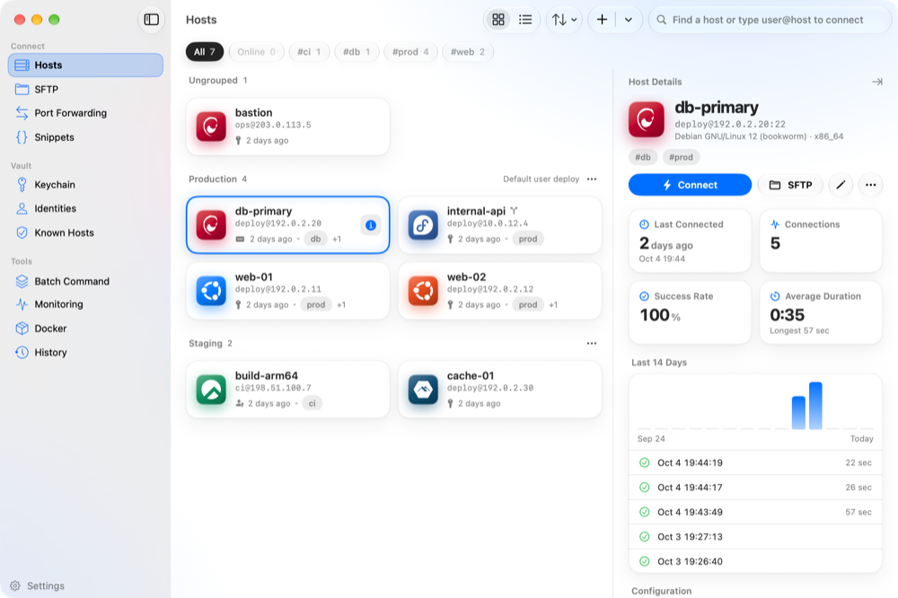
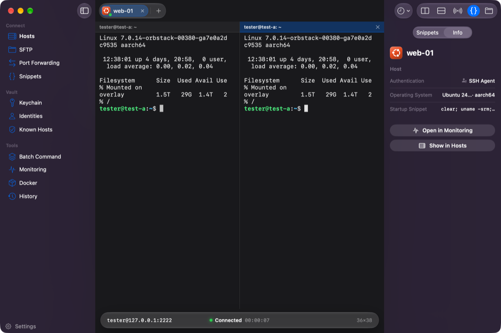
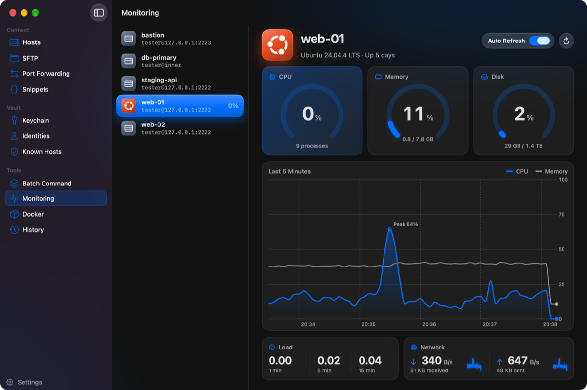
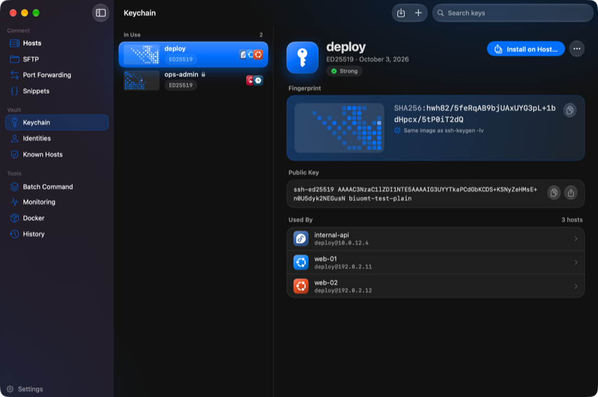
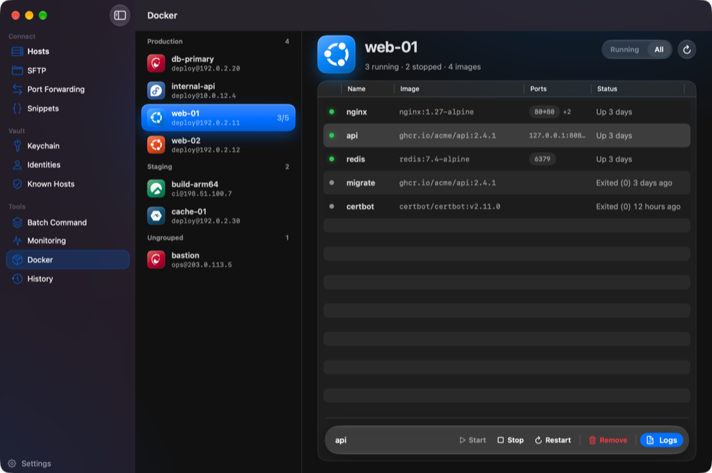
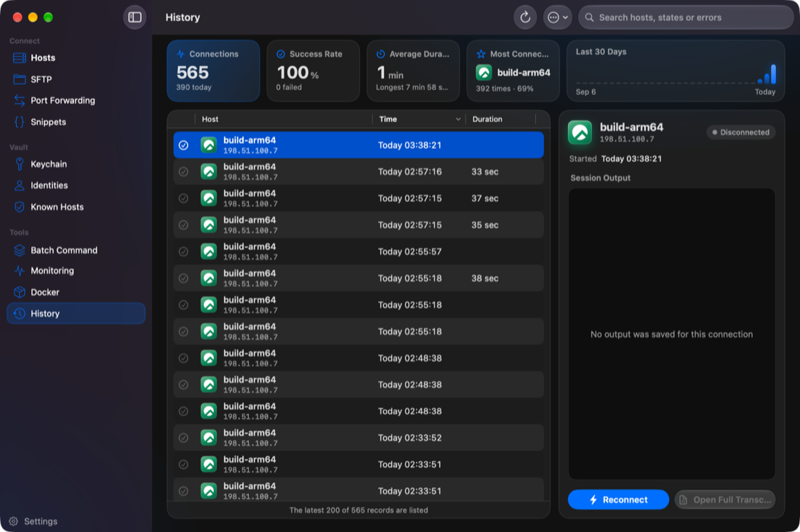
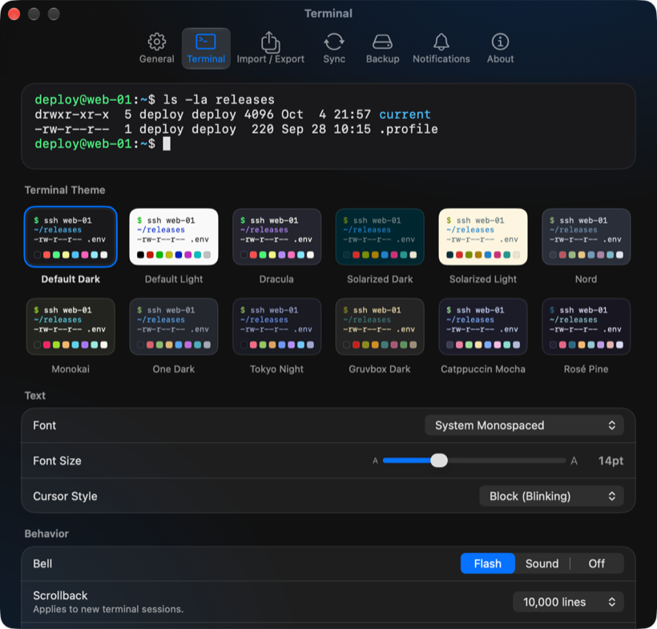

# Termi

A native macOS SSH client: hosts, terminals, SFTP, and port forwards on one connection per host, with secrets in a local encrypted vault.

Termi is a SwiftUI app. It drives the system OpenSSH client, keeps every tab, split, file transfer, and tunnel for a host on that host's shared connection, and stores passwords and private keys in its own database rather than in the macOS Keychain. On macOS 26 and later the interface uses Liquid Glass; on macOS 15 it uses the standard materials.

<picture>
  <source media="(prefers-color-scheme: dark)" srcset="docs/images/hosts-dark.png">
  
</picture>



| | |
|---|---|
|  |  |
|  |  |



The screenshots use sample data. How the pages work is in the [User Guide](docs/USER_GUIDE.md). What changed is in the [Changelog](CHANGELOG.md).

## Features

**SSH.** One OpenSSH `ControlMaster` per host. Terminal tabs, split panes, SFTP, port forwards, monitoring, Docker, and batch commands reuse it, so a new tab does not sign in again. Authentication is a password, a vault private key (with an optional passphrase), the system SSH agent, or a keyboard-interactive prompt (including 2FA). Passwords and passphrases can be saved into the vault from the prompt. A host can connect through another saved host (ProxyJump); each hop has its own credentials, and a chain stops at 8 hops. The first time a host key is seen, Termi asks you to trust the fingerprint and then stores it. A key that no longer matches is refused. Per host you can turn on agent forwarding and X11 forwarding (`ssh -X` for that session). Keep-alive and the connect timeout come from Settings. Dropped sessions reconnect with backoff, including after the network returns or the Mac wakes, when automatic reconnect is on. Optionally, readable settings from your own `~/.ssh/config` are applied: algorithm preferences (`Ciphers`, `MACs`, `KexAlgorithms`, and the host-key and public-key algorithm lists), and, for agent authentication, `IdentityAgent`, `IdentityFile`, and `CertificateFile`. `ProxyCommand` and `RemoteCommand` are not taken from that file.

**Terminal.** SwiftTerm draws the session. Tabs live in the toolbar. A tab can be split right (`⌘D`) or down (`⇧⌘D`); input can be broadcast to every pane of that tab. Tabs can be duplicated or renamed. Each window has its own tabs. A local login shell is available beside remote sessions. The status bar shows address, state, uptime, tunnels, and the grid size. The inspector holds snippets and session info. Find in the scrollback (`⌘F`), clear the buffer, and zoom the font. Snippets support `{{name}}` placeholders that must be filled in before the command is typed; a host can run one snippet as soon as its shell is ready. Appearance is per settings and can be overridden per host: font, cursor style, scrollback, bell, Option-as-Meta, copy on select, and close when the shell exits. The twelve built-in themes are Default Dark, Default Light, Dracula, Solarized Dark, Solarized Light, Nord, Monokai, One Dark, Tokyo Night, Gruvbox Dark, Catppuccin Mocha, and Rosé Pine. Session output is written to History.

**Hosts.** Cards or a list, with search. `⌘I` opens a side panel: connection counts (including the last 14 days), port forwards, route, and configuration. After a connection, the tile can show the operating system the host reported. Groups carry a default username, identity, and jump host. Tags filter the list; sort by name or recent use. The toolbar search connects immediately when you type `user@host` and press Return. `⌘T` opens a full-window picker: choose a saved host, paste `ssh user@host -p port`, open a local shell, select several hosts at once, or reopen a saved workspace (a named set of hosts). The command palette (`⌘K`) searches sessions, hosts, snippets, and pages; from there, Quick Connect opens a small dialog for `user@host[:port]` without creating a host record (a typed address that already matches a saved host connects as that host). Import an OpenSSH client config (`Host` defaults, `Include`, identity files copied into the vault, port forwards, and ProxyJump chains; hosts that are already present are skipped) or a CSV of host records. CSV export writes labels, addresses, usernames, auth type, group, notes, and config alias — not passwords or keys.

**SFTP.** An SFTP v3 client on the host's existing connection. Two panes (this Mac and the server), breadcrumbs, hidden files, and drag and drop between them. Upload, download, and delete can recurse; you can also rename, change permissions, and create a folder. A remote rename does not replace a file that is already there. Downloads and uploads go through a temporary `.part` file; replacing a local file moves the previous one to the Trash. Open a remote file in the default app; saving uploads it again. Local copies of edits that never made it back to the server are moved to the Trash rather than deleted.

**Port forwarding.** Local, remote, and dynamic (SOCKS) rules, stored with the host. Start and stop a rule on its own, or mark it to start when a terminal session to that host connects. The sidebar shows how many forwards are active.

**Vault.** The sidebar's Keychain page is the SSH key list, not the macOS Keychain. Generate an Ed25519 or 4096-bit RSA key with `ssh-keygen`, or import a key you already have. Each key shows a fingerprint image (the same picture as `ssh-keygen -lv`) and the hosts that use it. A public key can be installed into a host's `authorized_keys`. Identities are one username-and-credential set shared by many hosts or by a group. Known Hosts lists the keys you have trusted, grouped by machine.

**Tools.** Run one command on many hosts and read the results by host or grouped by output. The batch command's own history stays in memory for that visit (up to 50 entries) and is not written to the database. Monitoring collects CPU, memory, disk, load, uptime, and network counters over SSH, with an optional refresh every 5 seconds and a short trend. Docker lists containers on a host (`docker ps`, running only or all) and can start, stop, restart, remove, and show logs. History is the connection log: totals across every record, and the captured output of a session.

**Settings.** General (appearance, English or Simplified Chinese, reconnect, timeout, keep-alive, whether to read `~/.ssh/config`, SSH close confirmation, host OS detection, master password), Terminal, Import / Export, Sync, Backup, Notifications, and About. Notifications can fire for SSH connect, disconnect, and failure; for SFTP transfers that run longer than 3 seconds; and when a batch command finishes. Sync and backup are described under Security. About is where Sparkle's update check lives.

## Requirements

- macOS 15.0 or later. Liquid Glass is used on macOS 26 and later.
- To build: Xcode 26 (Swift 6, macOS 26 SDK) for the glass appearance. Xcode 16.2 on the macOS 15 SDK also builds and its tests pass; that build has no glass effects.
- [XcodeGen](https://github.com/yonaskolb/XcodeGen) only if you regenerate `Termi.xcodeproj`. The project is already committed.
- Swift packages, resolved by Xcode: [SwiftTerm](https://github.com/migueldeicaza/SwiftTerm) 1.18.x, [GRDB](https://github.com/groue/GRDB.swift) 7 or later, [Sparkle](https://github.com/sparkle-project/Sparkle) 2.6 or later.
- The system `ssh`, `ssh-keygen`, and (for acceptance tests) Docker.

## Build from source

```bash
git clone https://github.com/example/Termi.git
cd Termi
make build   # build/Termi.app — Release, ad-hoc signed
make dmg     # build/Termi-<version>.dmg
make clean
```

`xcodebuild` has to come from Xcode.app (`sudo xcode-select -s /Applications/Xcode.app`). Open `build/Termi.app`. An ad-hoc signature is not a Developer ID signature: if Gatekeeper blocks the first launch, right-click the app and choose Open.

This tree does not point at a published binary. `.github/workflows/release.yml` builds a DMG on a `v*` tag whose version matches `MARKETING_VERSION` in `project.yml`. In-app updates are not ready to ship: Sparkle's feed is the placeholder `https://example.com/appcast.xml` (`SUFeedURL` in `Termi/Resources/Info.plist`), and no Sparkle Ed25519 public key is set. Settings → About can still run a check; it will not install an update until that feed and key exist. Checks run only in the normal profile, not under the test or isolated-profile paths below.

Unit tests (they use a temporary profile and do not touch `~/Library/Application Support/Termi`):

```bash
xcodebuild test -project Termi.xcodeproj -scheme Termi -destination 'platform=macOS'
```

Acceptance tests against SSH servers in Docker, on a separate profile:

```bash
make test-env-up      # three servers on 127.0.0.1; secrets go in .test-env/
make run-isolated     # Debug build, TERMI_PROFILE_DIR=.test-env/profile
make test-env-down
```

See [docs/TESTING.md](docs/TESTING.md).

After adding or moving Swift files, regenerate the project with `xcodegen` from `project.yml`. Do not edit `project.pbxproj` by hand.

## Usage

1. Build and open the app, as above. The sidebar starts on **Hosts**.
2. Add a host (Host → New Host), import `~/.ssh/config` from Settings → Import / Export, or connect without saving a record: type `user@host` in the Hosts search field, or use the command palette (`⌘K`) → Quick Connect (`user@host` or `user@host:port`).
3. Pick password, private key, or SSH agent. A password or key passphrase can be stored in the vault from the prompt. Trust the host key when asked; a later mismatch is refused.
4. The session opens as a toolbar tab. `⌘T` is the host picker (saved hosts, `ssh user@host -p port`, several hosts, or a workspace). `⌘L` is a local terminal. `⌘D` / `⇧⌘D` split the focused pane.
5. SFTP (`⇧⌘O` on an SSH pane, or the sidebar) and port-forward rules use the same connection.
6. Optional: Settings → General → set a master password. `⇧⌘L` locks the windows. Sessions that are already connected stay connected behind the lock screen.

A second profile, for experiments, is `TERMI_PROFILE_DIR=/absolute/path open Termi.app`. That variable must be an absolute path, and it cannot point at the real profile folder or anything inside it.

| Shortcut | Action |
|----------|--------|
| `⌘N` | New window |
| `⌘T` | New tab — choose a host |
| `⌘L` | New local terminal |
| `⇧⌘N` | Same host picker as `⌘T` (menu title: Quick Connect) |
| `⌘K` | Command palette (Quick Connect dialog, SFTP with `⌘Return` on a host) |
| `⌘W` / `⇧⌘W` | Close the focused tab or pane (SSH asks first) / close the window |
| `⌘1`–`⌘9`, `⌘[` / `⌘]` | Switch tabs |
| `⌃⌘1` / `⌃⌘2` | Hosts / SFTP |
| `⌘D` / `⇧⌘D` | Split right / split down |
| `⌥⌘]` / `⌥⌘[` | Next / previous pane |
| `⇧⌘B` | Broadcast input to every pane of the tab |
| `⌘F`, `⌘G` / `⇧⌘G` | Find, find next / previous |
| `⌥⌘K` | Clear the buffer |
| `⇧⌘S` | Terminal inspector (snippets and info) |
| `⇧⌘O` | SFTP for the focused host |
| `⇧⌘R` | Reconnect |
| `⌘=` / `⌘-` / `⌘0` | Font size |
| `⌘I` | Show or hide the host details panel |
| `⌘R` | Refresh Monitoring, Docker, or History |
| `⌘Return` | Run the batch command |
| `⌘/` | Shortcut list |
| `⇧⌘L` | Lock (only after a master password is set) |
| `⌘,` | Settings |

`⌘/` opens the same list inside the app. Page-specific keys are in the [User Guide](docs/USER_GUIDE.md#keyboard-shortcuts).

## Project structure

```
Termi/
├── App/            # Entry (also the SSH askpass helper), menus, AppProfile (where data lives)
├── Models/         # GRDB records, terminal themes and preferences, host OS detection
├── Database/       # Database actor and migrations
├── Repositories/
├── Services/       # SSH engine, SFTP, vault and crypto, sync, import/export,
│                   # monitoring, Docker, notifications
├── ViewModels/     # One AppViewModel per window
├── Views/          # MainWindow, Sidebar, Terminal, Hosts, SFTP, Keys, DevOps,
│                   # Security, Settings, Shared
├── Theme/          # Layout, colour, and the only Liquid Glass wrappers (Glass.swift)
├── Utilities/
├── Resources/      # Info.plist, entitlements, asset catalog (including OS marks)
└── Localizable.xcstrings   # English and Simplified Chinese
TermiTests/         # Unit tests (Swift Testing), hosted in the app
docs/               # User guide, screenshots, third-party notices
scripts/            # build-release.sh, create-dmg.sh, string check, Sparkle key helper
TestEnvironment/    # Docker SSH image and test-env.sh
project.yml         # XcodeGen source of Termi.xcodeproj
```

Rules for visible UI live in `Termi/Views/AGENTS.md` and `Termi/Theme/AGENTS.md`.

| Piece | What it is |
|-------|------------|
| Language | Swift 6, strict concurrency |
| UI | SwiftUI, AppKit where a control needs it |
| Database | GRDB (SQLite, WAL) |
| SSH | System OpenSSH with a generated config and an askpass helper |
| SFTP | In-app SFTP v3 client on the shared connection |
| Terminal | SwiftTerm 1.18.x |
| Secrets | CryptoKit AES-256-GCM; PBKDF2-SHA256 for the master password |
| Updates | Sparkle (feed still a placeholder; see Build from source) |

## Security

Secrets are encrypted at rest with AES-256-GCM. They are not stored in the macOS Keychain. The sidebar label "Keychain" is only the name of the key list.

With no master password, a random 256-bit key is written to `~/Library/Application Support/Termi/.vault-key` (mode `0600`, complete file protection; the profile directory is `0700`). The vault unlocks on its own with that file. Anyone who can read the file can decrypt the vault. Setting a master password derives the key with PBKDF2-SHA256 (600,000 iterations). Locking (`⇧⌘L`) clears that key from memory and covers the windows, including Settings. SSH sessions that are already up keep running; the lock screen shows only how many, not which hosts. There is no Touch ID or other biometric unlock.

Host passwords, identity passwords, private keys, and key passphrases go through the vault. Generated `ssh` configs set `UseKeychain no`, so a passphrase is not copied into the macOS Keychain, and passphrases are supplied through the askpass helper rather than as process arguments. While a vault key is being forwarded, the app uses a private `ssh-agent` for that key.

What is not encrypted: hostnames, usernames, labels, notes, tags, connection-log metadata, and terminal preferences. Session transcripts under `SessionLogs/` in the profile directory are plain text. A database backup does not include `.vault-key`. Without a master password, restoring that backup on another Mac cannot decrypt saved secrets. Settings → Sync writes a password-protected encrypted export (hosts, groups, keys, identities, known hosts, forwards, snippets, vault entries, and connection logs) for moving a profile between Macs. Nothing is uploaded; there is no cloud sync.

Suggested backup folder: `~/Documents/Termi`. Sync files for the normal profile: `~/.termi/sync`. `TERMI_PROFILE_DIR` keeps the database, vault key, transcripts, sync files, backups, and preferences inside the folder you name.

The app is not sandboxed (`com.apple.security.app-sandbox` is false). It is a network client and can read and write files you pick.

Host keys use trust-on-first-use (`StrictHostKeyChecking ask` on the generated config). A changed key is refused until you deal with it; it is not replaced silently.

## Contributing

There is no separate contributing guide, and `.github/` has no issue or pull-request template. Open a pull request against `main`. CI (`.github/workflows/ci.yml`) builds Release and runs the unit tests twice: Xcode 26 on macOS 26, and Xcode 16.2 on macOS 15. A push that only touches Markdown, `docs/`, or `Casks/` does not start that workflow; a pull request does.

Before sending a change that adds user-visible strings, run `make check-strings` so `Termi/Localizable.xcstrings` still has a Simplified Chinese translation for each string and no unused entries. Keep Liquid Glass calls inside `Termi/Theme/Glass.swift`, behind the macOS 26 availability check, so the macOS 15 toolchain still compiles.

## Third-party marks

Operating-system marks on host tiles come from [Simple Icons](https://simpleicons.org) (CC0 1.0) and are trademarks of their owners. Package licenses are listed in [docs/THIRD_PARTY_NOTICES.md](docs/THIRD_PARTY_NOTICES.md).

## License

Termi is released under the [MIT License](LICENSE).
