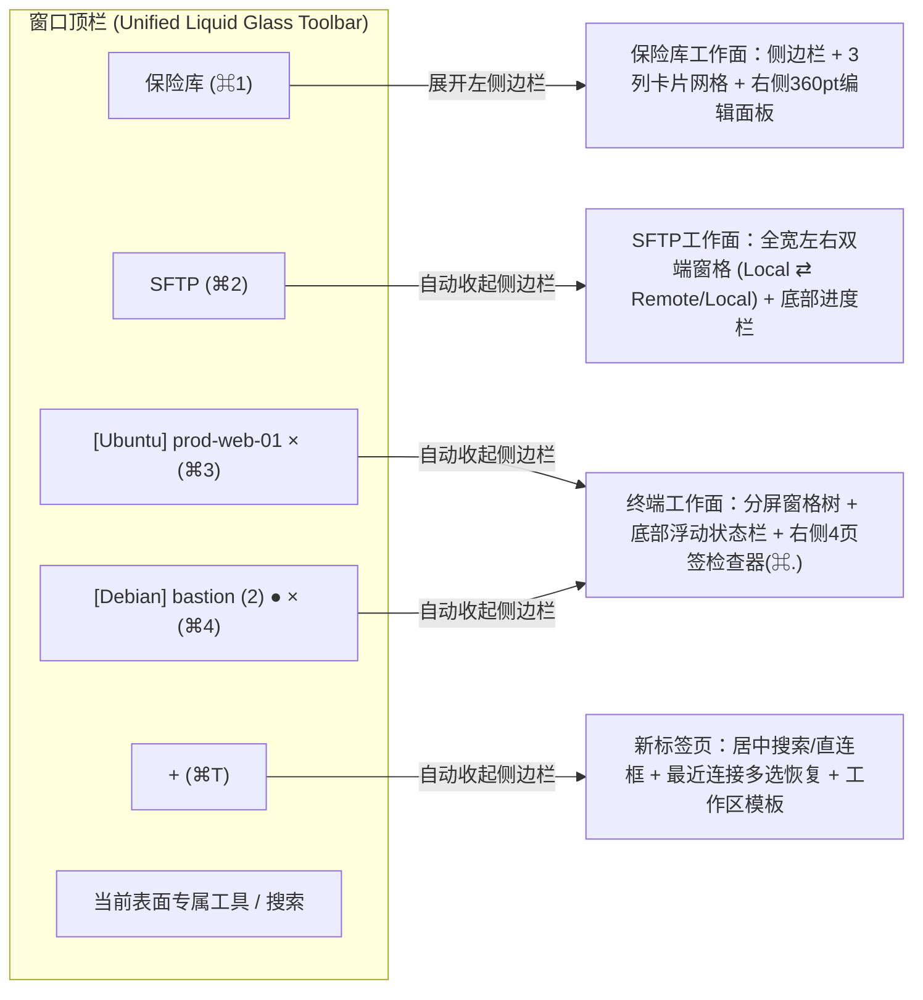
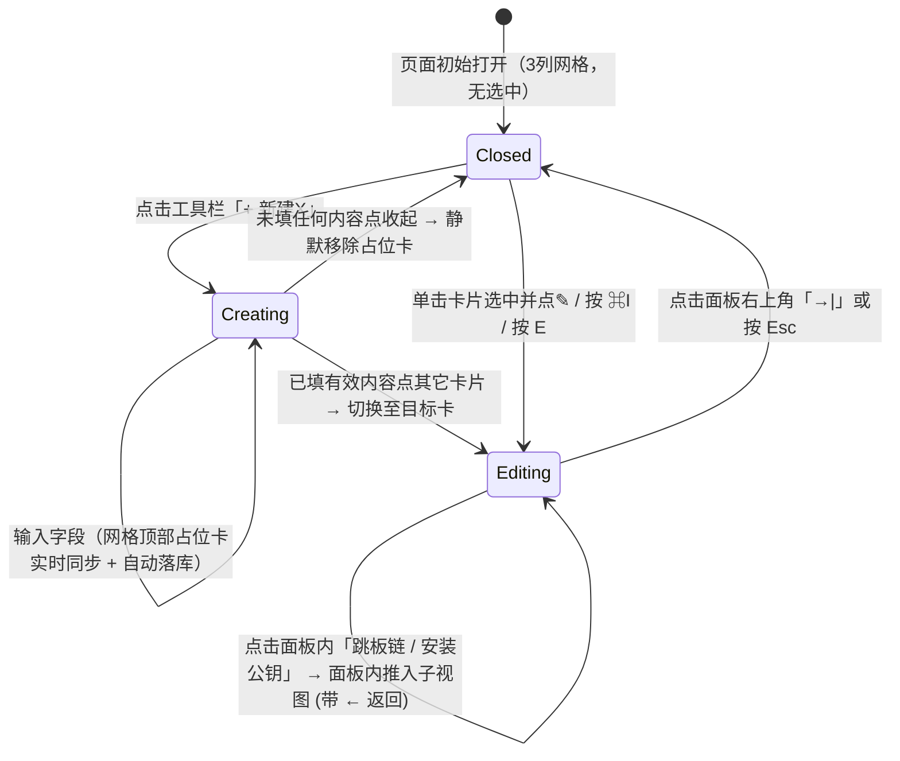

# Termi UI 审计与重构规范（Termius 交互逻辑 × Apple Liquid Glass × ADA 工艺）

> **版本**：2026-10-18 定稿  
> **目标**：将 Termi 的信息架构与交互流程全面对齐 **Termius 桌面版（10.x）** 的高效直觉，同时严格保持 **Apple Liquid Glass 视觉皮肤** 与 **Apple Design Award (ADA)** 级别的 macOS 原生工艺。  
> **证据基础**：
> - 本机 Termius 实机交互取证：29 张实拍图与观察记录（`$S/audit/termius/INDEX.md`）
> - Termius 机制与源码静态调研：`termius-hosts.md`、`termius-terminal.md`、`termius-tools.md`
> - ADA 与 macOS 26 HIG 工艺清单：`ada-craft.md`
> - Termi 现状全量实拍：134 张深/浅色、空/满/连接态截图（`$S/audit/shots/INDEX.md`）
> - 分域审计底稿：`audit-hosts-shell.md`、`audit-terminal.md`、`audit-tools-vault.md`

---

## 一、核心设计原则（7 条铁律）

1. **右侧检查器就地新建与编辑，零模态表单（Inspector-First, Zero Modal Forms）**
   - 主机、分组、端口转发规则、SSH 密钥、身份、代码片段的**新建与编辑一律在右侧 360–380pt 检查器面板内就地完成**，彻底废除遮挡主视图的 `.sheet` 模态表单。
   - **实时占位与自动保存**：点击 `+ 新建` 时，左侧网格顶部立即插入一张带强调色描边的实时占位卡片（随右侧输入实时更新标题/副标题/图标），右侧表单字段修改即时落库并接入 `UndoManager`（支持 `⌘Z` 撤销）；若新建项未填任何有效内容即关闭面板，自动静默丢弃占位卡。
   - **底部唯一主操作**：面板底部不设「保存 / 取消」，而是固定该对象的**唯一核心动作**（主机：`连接 Connect`；代码片段：`运行 Run`；端口转发：`启动转发 Start`；公钥导出：`安装并绑定`）。

2. **顶栏作为第一工作面切换器，全幅让位给终端与 SFTP（Top Surface Switcher）**
   - 窗口顶栏左侧常驻 **`保险库 (Vaults, ⌘1)`** 与 **`SFTP (⌘2)`** 两个玻璃切换胶囊，右侧紧接活动终端/工作区标签流与 **`+`（`⌘T`）**。
   - 侧边栏**仅在 `保险库` 工作面内展开**；切换到任何终端会话标签或 `SFTP` 工作面时，左侧边栏自动收起（可通过 `⌃⌘S` 临时呼出），将 100% 窗口宽度让给多窗格终端和双面板文件浏览。

3. **统一保险库页面模板（One Vault Page Template）**
   - 所有保险库数据页（**主机、密钥与身份、端口转发、代码片段、已知主机**）共用同一套骨架：
     - **工具栏行**：左起为 `+ 新建〈对象〉 ▾` 分裂主按钮（主按钮触发最高频创建，下拉菜单提供次级创建如 `新建分组`、`从 ~/.ssh/config 导入`、`生成密钥`）+ 次级文字快捷按钮（如主机页的 `本地终端 ⌘L`）；右侧为页面搜索框、筛选器、网格/列表切换、排序菜单。
     - **内容区**：默认 **3 列卡片网格**（右侧检查器展开时自动重排为 **2 列**；900pt 最小窗下为 2 列 / 1 列）。
     - **极简双行卡片**：每张卡片仅包含 **40pt 圆角图标块（`DSHostAvatar` / `DSIconTile`）+ 第 1 行粗体名称 + 第 2 行安静副标题**（如 `ssh · deploy@10.0.1.11` 或 `ED25519 · SHA256:4rTb…`），悬停/选中时卡片右缘浮现**铅笔（编辑/详情）按钮**。不在卡片上堆砌第 3 行标签胶囊与相对时间。
     - **安静空状态**：除主机页首次空状态提供 `~/.ssh/config` 自动探测数量与一键导入外，其余子页空状态仅居中展示图标块 + 标题 + 一句话说明，不在正中央重复放置与左上角工具栏相同的新建按钮。

4. **从想连到连上只需一次按键序列（`⌘T` 新标签选主机）**
   - 按 `⌘T` 或点顶栏 `+` 打开一个**全窗口新标签页（New Tab Host Picker）**，而非直接开本机 shell 或弹模态框。
   - 页面中央顶部为大号搜索框（自动聚焦，直接打字搜主机、搜已开标签、或输入 `ssh user@host -p port` 回车直连，右侧内嵌 `本地终端 ⌘L` 按钮），下方为**最近连接列表**（支持 `⌘/⇧` 多选后一键 `恢复会话` 或 `存为分屏工作区`）及已保存的**工作区模板**。

5. **连接生命周期内联于终端窗格，后台状态一目了然（In-Pane Lifecycle & Needs-Input Signal）**
   - 连接步骤条（TCP → 跳板机 → 指纹校验 → 认证 → 就绪）、密码/口令/2FA 认证输入、首次主机指纹确认、以及可展开的排障日志**全部内联在对应终端窗格的状态卡片内**，并发连接多台主机时绝不弹窗抢夺当前活动终端的键盘焦点。
   - 会话标签与分屏窗格头精准区分 4 种状态：**已连接/有新输出（绿点）**、**等待用户输入密码/确认（琥珀色点 + 钥匙微标）**、**连接失败（红点 + `!`）**、**已结束（灰点）**，且每个状态点均配无障碍文字与非颜色字形。

6. **Liquid Glass 视觉纪律与「同一信息只出现一处」**
   - 玻璃材质仅用于导航与控件层（侧边栏、顶栏胶囊、按钮、底部浮动状态栏、弹层），**内容层卡片与表格绝不用玻璃、不叠玻璃**；所有玻璃 API 唯一收敛于 `Termi/Theme/Glass.swift`。
   - 中性表面 + 单一强调色（`Color.accentColor`）+ 状态色（绿/橙/红必配文字或字形）+ 主机发行版专属色（`DSHostAvatar`）。
   - **没有的东西绝不画占位**：未连接过或无日志记录的主机，不画 `连接次数 —`、`成功率 —` 破折号卡片，不画空图表。

7. **原生 macOS 可原谅性与全键盘/无障碍满分（ADA Craft）**
   - **可撤销（`⌘Z`）**：本地元数据（主机、分组、密钥、身份、转发规则、片段、标签移动）的增删改接入 `UndoManager`，菜单显示「撤销删除主机 prod-web-01」，删除恢复原 `id` 与历史关联。
   - **菜单栏全覆盖与全键盘控制**：新增 `主机 (Host)` 与 `前往 (Go)` 菜单；所有仅图标按钮显式提供 `.accessibilityLabel`；移除中文字体上的负 `.tracking`；全面适配 `Reduce Motion`、`Reduce Transparency`、`Increase Contrast` 与 `Differentiate Without Color`。

---

## 二、跨页面核心交互模型规格

### 2.1 窗口顶栏与表面切换（Top Bar & Surface Architecture）

- **快捷键映射（macOS 原生习惯 + Termius 兼容）**：
  - `⌘1`：切到「保险库（Vaults）」工作面
  - `⌘2`：切到「SFTP」双端文件工作面
  - `⌘3`…`⌘8`：切到第 1…6 个终端/工作区标签；`⌘9`：切到最后一个标签
  - `⌘T`：打开「新标签页（New Tab Host Picker）」
  - `⌘L`：在当前新标签页或新标签中直接打开「本地终端」（SFTP 页面聚焦路径栏时仍支持点空白处或 `⌘L` 编辑路径）
  - `⌘K`：打开全局命令面板（模糊匹配主机、已开标签、快速连接、以及带拼音首字母检索的菜单动作）
  - `⌘I` 或 `E`：在保险库页面打开/收起选中卡片的右侧编辑详情面板
  - `⌘.` 或 `⇧⌘S`：在终端工作面展开/收起右侧 4 页签检查器
  - `⌘D` / `⇧⌘D`：终端向右 / 向下分屏；`⇧⌘B`：开关分屏广播输入；`⇧⌘M`：分屏 Focus ⇄ Split 视图切换

### 2.2 右侧检查器就地编辑状态机（Live Inspector State Machine）

---

## 三、逐页审计问题与重构规格清单（P0 / P1 / P2）

### 3.1 主机与分组页（Hosts & Groups）

| 编号 | 优先级 | 现状问题（含截图/代码定位） | 重构规格 |
|---|---|---|---|
| **SH-01** | **P0** | 终端与 SFTP 页面下左侧边栏仍常驻占去 228pt（`MainWindowView.swift:21`、`shots/63`、`shots/113`）。 | 顶栏左侧固定 `保险库 (⌘1)` 与 `SFTP (⌘2)` 胶囊；进入终端标签或 SFTP 时自动收起侧边栏，进入保险库时自动展开。 |
| **SH-02** | **P0** | `⌘T` 直接新建本机终端，快速连接又是独立 Sheet（`shots/15`、`TabBarView.swift:32`）。 | 新建 `NewTabPickerView` 作为 `⌘T` / `+` 的目标页：含搜索/直连框、`本地终端 (⌘L)` 按钮、最近连接列表（支持多选恢复或存为工作区）、工作区模板列表；移除 `QuickConnectView` 模态 Sheet。 |
| **HO-01** | **P0** | 主机卡片 3 行信息 + 标签胶囊堆砌，悬停出 `ⓘ` 只读（`shots/02`、`04`）。 | 改为 **40pt `DSHostAvatar` + 双行文字（第 1 行主机名 + 跳板微标；第 2 行 `ssh · user@host`）**；悬停/选中右缘出 `✎` 按钮，一键打开右侧可编辑详情面板；单击选中，双击或按 `↵` 直接连接。 |
| **HO-02** | **P0** | 首次灌入种子数据时分组标题与发行版色块不显示（`shots/01-hosts-grid-fresh.png`）。 | 修复 `HostsViewModel.loadHosts()` 初次加载顺序，确保分组与 `os_*` 图标首次即正确渲染。 |
| **ED-01** | **P0** | 新建/编辑主机与分组弹出模态 Sheet（`shots/11`、`12`、`13`），详情面板 `HostDetailView` 不可直接编辑。 | 将 `HostDetailView` 与 `HostFormView` 合并为右侧 360–380pt 的 `HostInspectorView`：支持就地新建（网格顶部插入实时占位卡）与实时自动保存编辑，底部固定唯一主按钮 `连接 (Connect)`。 |
| **ED-02** | **P0** | 表单字段未按高频直觉分层，跳板机无法在面板内直观编排（`shots/11`、`110`）。 | 字段顺序：① **地址卡片**（图标块 + IP/主机名）→ ② **通用**（名称、分组、标签）→ ③ **SSH 端口 `[22]` 与凭据**（用户名/身份下拉、密码、密钥卡片、多主机复用凭据提炼提示）→ ④ **终端主题卡片** → ⑤ **高级折叠区**（跳板链子页、代理转发、启动片段、X11、备注）→ ⑥ **连接统计与活动摘要**（仅在有真实连接记录时显示）。 |
| **ED-03** | **P0** | `HostDetailView` 在无日志记录时画出 `连接次数 —`、`成功率 —` 破折号卡与空 14 天横条（`shots/05`）。 | 严格按 `logs.count > 0` 控制统计卡与 14 天活动图渲染，彻底消除 `—` 占位卡。 |
| **ED-04** | **P0** | 端口转发规则编辑混在主机表单底部（`HostFormView`）。 | 主机编辑面板不再内嵌端口转发编辑器；若该主机有关联转发规则，仅显示紧凑开关行与「在端口转发中打开」链接。 |
| **HO-04** | **P1** | 分组仅作纯文本小节头，不支持双击整组连接或展示继承提示（`shots/02`、`13`）。 | 分组支持右键「在工作区连接整组主机」与右侧面板就地编辑默认凭据/跳板；主机编辑器中继承字段用动态 placeholder 显示 `继承自 Production：deploy`。 |

### 3.2 终端、分屏工作区与右侧 4 页签检查器（Terminal & Inspector）

| 编号 | 优先级 | 现状问题（含截图/代码定位） | 重构规格 |
|---|---|---|---|
| **TM-01** | **P0** | 后台标签缺少「等待输入（密码/指纹）」与「未读输出」状态（`TabBarView.swift`、`shots/69`）。 | 新增 `needsInput`（琥珀色 + 钥匙/问号字形）与 `unreadOutput`（绿/蓝圆点）状态，无障碍标签同步播报。 |
| **TM-03** | **P0** | 连接状态卡缺少步骤进度、可展开日志与失败后的闭环动作（`shots/64`、`65`、`66`）。 | `SessionStateCard` 增加 **步骤进度条**（TCP → 跳板 → 指纹 → 认证 → 就绪）、右上角 `显示日志 / 拷贝日志` 按钮、底部 `编辑主机` + `重新连接 ↵`（公钥被拒时直接给 `安装公钥…` 按钮）。 |
| **TM-04** | **P0** | askpass 密码提示与主机指纹确认弹全局窗口，并发连接时抢焦点（`shots/29`、`30`、`115`）。 | 将终端会话的密码/口令/2FA 输入与首次主机指纹确认**内联进该窗格的 `SessionStateCard`**（支持「保存密码到保险库」开关）；**指纹变化警告**保留红色高危对比卡片（新旧 randomart 并排，**默认按钮为取消**）。 |
| **TM-07** | **P0** | 终端右侧检查器只有「代码片段 / 信息」两页，不能即时预览切换主题或查看本机历史命令，且浅色模式下底色突兀（`SnippetPanelView.swift`、`shots/72`、`73`、`L09`）。 | 升级为 **4 个图标页签**（快捷键 `⌘.` 或 `⇧⌘S`）：① **查找与补全**（缓冲区搜索 + 选项）· ② **代码片段**（支持就地 `+ 新建`、悬停 `粘贴 / 运行`、`{{变量}}` 填空）· ③ **命令历史**（当前主机历史命令一键粘贴或存为片段）· ④ **外观**（字号步进 + 12 套主题缩略图 `↑/↓` 实时预览应用到当前主机）；检查器表面色调与终端主题协调过渡。 |
| **TM-02** | **P1** | 同名主机多开标签无 `(2)` 序号，无就地改名与中键关闭（`TabBarView.swift`）。 | 增加同名标签 `(2)` 编号、右键/双击标签就地重命名、鼠标中键关闭、断开态右键菜单首项 `重新连接`。 |
| **TM-05** | **P1** | 会话意外断开或退出后，居中大卡片遮挡终端最后输出的报错信息（`shots/67`、`68`）。 | 已有终端输出缓冲的会话断开时，保留完整屏幕输出，在窗格底部吸附紧凑重连栏，支持在终端内按 `↵` 或 `空格` 直接重连。 |
| **TM-06** | **P1** | 分屏不支持保存为工作区模板，不支持拖标签合入分屏或拖窗格回标签栏（`shots/70`、`71`）。 | 支持保存本地「工作区模板」、拖拽主机/标签到窗格分屏打开、拖拽分屏窗格头拆回独立标签，以及 `⇧⌘M` 聚焦/分屏切换。 |

### 3.3 SFTP 双端文件浏览器（SFTP Browser）

| 编号 | 优先级 | 现状问题（含截图/代码定位） | 重构规格 |
|---|---|---|---|
| **SF-01** | **P0** | 未连接时整页都是选主机网格（`shots/76`、`114`），左栏看不到本机文件；且左栏锁死本机、右栏锁死远程（`SFTPView.swift:40-50`）。 | SFTP 始终展示**左右双窗格**；每个窗格可独立设为 `本地 (这台 Mac)` 或 `任意远程主机`。右窗格初始显示空状态卡（`连接到主机` + `选择主机` 按钮）；点 `选择主机` 或窗格头主机名时，**在该窗格内部原地展开紧凑主机选择器**（含搜索、标签过滤、排序及 `本地文件系统` 选项，`termius/11`–`12`）。 |
| **SF-02** | **P1** | 窗格缺少独立实时过滤框、点击当前面包屑刷新、点击路径栏空白处编辑路径、首行 `..` 返回上级；表格行高偏大（`shots/79`、`82`）。 | 每个窗格头部配独立 `过滤` 搜索框与 `操作 ▾` 菜单；路径栏支持后退/前进、点面包屑段跳转、点当前段刷新、点空白处（或 `⌘L`）切换为路径输入框；文件表首行加 `..` 父目录，行高收敛至紧凑 26pt。 |
| **SF-03** | **P1** | 远程文件外部编辑后的上传确认与切换主机防丢保护需对齐 Termius（`SFTPView.swift:53-57`）。 | 底部保留 `EditItemsBar`（支持自动上传或一键确认上传/放弃），在窗格切换目标主机或关闭前若有未上传修改弹确认框；同名冲突对话框以 `保留两者 (Duplicate)` 为默认主按钮，文件夹支持 `合并 (Merge)`。 |

### 3.4 保险库子页（端口转发、密钥库、身份、代码片段、已知主机）

| 编号 | 优先级 | 现状问题（含截图/代码定位） | 重构规格 |
|---|---|---|---|
| **VT-01** | **P0** | 密钥、身份、端口转发、代码片段、已知主机各自为政（左窄列表或单列行 + 模态 Sheet，`shots/20`–`37`）。 | 全部切换为 **Unified Vault Template**：工具栏左侧 `+ 新建〈对象〉 ▾` 分裂按钮 + 右侧搜索/网格列表切换/排序；主区 3 列双行卡片网格（面板打开时 2 列）；右侧 360pt 自动保存检查器面板。 |
| **VT-02** | **P0** | 端口转发新建/编辑弹两层模态 Sheet（`shots/33`、`34`），不支持双击卡片启停与向导模式。 | 端口转发卡片以路线（或自定义名称）作主标题，**双击或按 `↵` 直接启停**；右侧面板内含 `本地 -L / 远程 -R / 动态 -D` 分段控件、实时路线图 `DSRouteDiagram`、内联主机选择器、自动保存字段、底部 `启动转发` 主按钮，以及 `分步向导 ⇄ 完整表单` 切换（`termius/07`–`08`）。 |
| **VT-03** | **P0** | 密钥生成、导入、安装公钥到主机均弹模态 Sheet（`shots/22`–`24`）；身份新建/编辑弹模态 Sheet（`shots/26`、`107`）。 | 密钥与身份在右侧面板内就地新建/编辑/生成：面板内支持拖拽私钥文件导入、只读公钥一键拷贝、`DSRandomart` 指纹图、以及面板内子视图「安装公钥到主机（一键写入 `authorized_keys` 并绑定到主机凭据）」。 |
| **VT-04** | **P1** | 代码片段新建/编辑弹模态 Sheet（`shots/37`）。 | 代码片段在右侧面板内就地新建/编辑：含名称、分类、脚本框、`{{变量}}` 实时占位芯片与试填、目标主机/会话选择、底部固定 `运行 (Run)` 主按钮。 |
| **VT-05** | **P1** | 已知主机不支持一键「保存为主机」（`shots/27`–`28`）。 | 已知主机卡片右键与右侧详情面板提供 `转为主机 (Convert to Host)`，点击跳到主机页右侧面板并预填地址与端口。 |

### 3.5 运维工具、历史记录、设置与全应用 ADA 工艺（Tools, Logs, Settings & Craft）

| 编号 | 优先级 | 现状问题（含截图/代码定位） | 重构规格 |
|---|---|---|---|
| **TL-05** | **P0** | 仅图标按钮缺 `.accessibilityLabel`、中文标题负字距 `.tracking(-0.5)`、未全量接入 `Reduce Motion` / `Reduce Transparency` / `Increase Contrast`、缺少 `UndoManager`（`ada-craft.md` F2, G1, G6-G8, H4）。 | ① 去掉所有本地化标题上的负 `.tracking`；② `Theme/` 所有图标按钮补齐 `.accessibilityLabel`；③ `DS.Motion` 统一响应 `accessibilityReduceMotion`；④ 接入 `UndoManager` 支持 `⌘Z` 撤销本地元数据增删改；⑤ 核验 8 种系统强调色在深/浅模式下的选中文字对比度。 |
| **TL-01** | **P1** | 历史记录点「查看完整输出」弹模态 Sheet（`shots/94`），且无书签防过期机制。 | 历史记录支持 **书签钉住（Bookmark，免除 90 天自动清理，可加备注）**；完整会话转录在右侧面板或独立只读标签页中打开（支持 `⌘F` 搜索），废除模态 Sheet `94`。 |
| **TL-02** | **P1** | Docker 容器日志弹模态 Sheet（`shots/44`）。 | 容器日志改为在 Docker 页右侧 380pt 检查器面板中展开（支持流式刷新、行数选择、搜索、拷贝）。 |
| **TL-04** | **P1** | 设置窗口缺少独立的 `SFTP` 与 `快捷键` 分页，浅色调试启动下通用页外观分段显示不一致（`shots/46`–`53`、`shots/L13`）。 | 设置窗口补齐 `SFTP` 与 `快捷键` 分页（将 `19-keyboard-shortcuts.png` 纳入设置窗口并保留 `⌘/` 呼出）；修复外观分段控件与当前有效外观的同步。 |

---

## 四、设计画板与交互原型清单（Interactive Design Canvas）

我们基于项目的 Liquid Glass 共享样式令牌与发行版 SVG 图标库，制作了包含 **8 张核心重构画板（支持深色 / 浅色实时切换与画板切换）** 的交互式设计原型文件：
- **文件路径**：[docs/ui-redesign-canvas.html](ui-redesign-canvas.html)

| 画板编号 | 画板名称 | 展示的核心交互与视觉规格 |
|---|---|---|
| **Artboard 1** | **主机页 + 右侧就地编辑面板 (`HostsEditor`)** | 顶栏 `保险库 / SFTP / 会话标签 / +` 切换器；左侧保险库导航；中部重排为 2 列的双行极简卡片网格（顶部含正在新建/编辑的实时选中卡片）；右侧 360pt 自动保存编辑器（地址卡、通用、SSH 端口与凭据、跳板链入口、主题缩略图、底部固定 `连接` 主按钮）。 |
| **Artboard 2** | **`⌘T` 新标签页：主机选择器与工作区恢复 (`NewTabPicker`)** | 全幅无侧边栏新标签页；居中大号搜索与 `ssh user@host` 直连框 + `本地终端 ⌘L`；下方「最近连接」多选列表（底部浮现 `存为工作区` 与 `恢复 2 个会话 ↵`）及「工作区模板」卡片。 |
| **Artboard 3** | **SFTP 双端浏览器 + 窗格内选主机 (`SFTPDualPane`)** | 全幅无侧边栏双窗格；左窗格 `本地 (这台 Mac)` 紧凑文件表（含过滤框、可编辑面包屑、`..` 行）；右窗格原地展开「选择主机」列表（含 `本地文件系统` 按钮、标签筛选、搜索）；底部单行传输进度条与远程编辑上传确认条。 |
| **Artboard 4** | **端口转发网格 + 右侧向导/表单面板 (`PortForwardInspector`)** | 统一 Vault 工具栏（`+ 新建规则 ▾`）；路线标题卡片网格（双击启停）；右侧 360pt 面板（`本地 -L / 远程 -R / 动态 -D` 分段、实时路线图 `DSRouteDiagram`、自动保存表单与向导切换、底部 `启动转发` 主按钮）。 |
| **Artboard 5** | **密钥与身份库 + 右侧面板安装公钥 (`KeychainInspector`)** | 统一 Vault 卡片网格（密钥 + 身份）；右侧面板展示拖拽导入区、只读公钥一键复制、`DSRandomart` 指纹图，以及面板内联「安装公钥到主机」子视图。 |
| **Artboard 6** | **终端工作面 + 右侧 4 页签检查器 (`TerminalInspector`)** | 全幅分屏终端 + 底部胶囊状态栏 + 右侧 4 图标页签检查器（当前展示「外观与主题」页签：字号步进器 + 12 套主题缩略图实时预览，以及「命令历史 / 代码片段 / 信息」页签切换）。 |
| **Artboard 7** | **终端窗格内联连接进度与指纹/认证卡 (`TerminalConnecting`)** | 双窗格并发连接场景：左窗格展示步骤进度环（TCP → 跳板 `bastion` → 指纹校验 → 认证 → 就绪）+ 内联密码输入 + 可展开连接日志；右窗格展示首次 SHA256 指纹 + Randomart 内联确认卡（不抢左窗格焦点），顶栏标签显示琥珀色「等待输入」状态点。 |
| **Artboard 8** | **代码片段网格 + 右侧 `{{变量}}` 编辑器 (`SnippetsInspector`)** | 统一 Vault 卡片网格；右侧自动保存编辑器（脚本编辑框、自动提取的 `{{unit}}` / `{{lines}}` 变量芯片与默认值、目标执行主机多选、底部固定 `运行` 主按钮）。 |

---

## 五、分阶段实施工作包拆分（Workpackages）

为保证工程可编译、可测试、互不踩踏，后续代码实施拆分为 **5 个无重叠工作包（WP1–WP5）**：

### WP1：共享设计层、无障碍与统一保险库容器（`Theme/` & `Undo`）
- **涉及文件**：`Termi/Theme/DesignSystem.swift`、`Glass.swift`、`Components.swift`、`Tiles.swift`、`Termi/Views/AGENTS.md`。
- **内容**：
  1. 新增统一保险库页面外壳组件 `DSVaultPage`（封装分裂主按钮工具栏、自适应 3 列/2 列卡片网格、按需滑出的 360pt 右侧检查器容器 `DSInspectorPanel`）。
  2. 移除所有中文/本地化标题上的负 `.tracking`；补齐所有图标按钮的 `.accessibilityLabel`。
  3. 在 `DS.Motion` 与 `Glass.swift` 中统一接入 `accessibilityReduceMotion`、`accessibilityReduceTransparency`、`colorSchemeContrast`、`accessibilityDifferentiateWithoutColor`。
  4. 扩展 `DSHostAvatar.Status` 支持 `.needsInput`（琥珀色 + 钥匙微标）与 `.unread`（未读输出点）。
- **退出条件**：`make build` 通过，Design Gallery 样张页在深/浅色及辅助功能开关下渲染无误。

### WP2：窗口顶栏工作面切换、`⌘T` 新标签选主机页与菜单栏补齐（`MainWindow/`、`Sidebar/`、`Shared/`、`App/`）
- **涉及文件**：`MainWindowView.swift`、`SidebarView.swift`、`TabBarView.swift`、`TermiApp.swift`、`AppViewModel.swift`，新增 `Views/Shared/NewTabPickerView.swift`。
- **内容**：
  1. 顶栏左侧加入常驻 `保险库 (⌘1)` 与 `SFTP (⌘2)` 切换器；在终端与 SFTP 表面自动收起左侧边栏。
  2. 实现 `NewTabPickerView`（居中搜索/直连框、`本地终端 ⌘L`、最近连接多选恢复、工作区模板），绑定 `⌘T` 与顶栏 `+`，移除 `QuickConnectView` 模态 Sheet。
  3. 标签栏补齐同名序号 `(2)`、就地重命名、鼠标中键关闭、断开态右键 `重新连接`。
  4. `TermiApp.swift` 补齐 `主机 (Host)` 菜单、`前往 (Go)` 菜单与 `SidebarCommands()`。
- **退出条件**：`⌘1` / `⌘2` / `⌘3…9` / `⌘T` / `⌘L` 切换流畅，单元测试与编译全绿。

### WP3：主机与分组页重构——双行极简卡片 + 右侧就地自动保存编辑器（`Views/Hosts/`、`ViewModels/HostsViewModel.swift`）
- **涉及文件**：`HostListView.swift`、`HostRowView.swift`、`HostDetailView.swift`、`HostFormView.swift`、`GroupFormView.swift`、`HostsViewModel.swift`。
- **内容**：
  1. 主机卡片精简为 40pt `DSHostAvatar` + 双行文字，悬停右缘显示 `✎` 按钮；修复首次种子灌入时分组与系统图标不刷新问题（`HO-02`）。
  2. 将 `HostDetailView`、`HostFormView`、`GroupFormView` 整合为右侧就地自动保存面板 `HostInspectorView` / `GroupInspectorView`：支持新建时网格顶部实时占位卡、空新建自动丢弃、跳板链面板内子页、分组默认值继承动态 placeholder、底部固定 `连接` 按钮。
  3. 消除无连接记录时的 `—` 统计占位卡与空 14 天横条（`ED-03`）；接入 `UndoManager` 支持 `⌘Z` 撤销删除/修改。
- **退出条件**：主机与分组的新建、编辑、删除撤销、搜索直连全部在单页右侧面板闭环完成，零模态 Sheet。

### WP4：保险库子页统一重构与双端 SFTP（`Views/Keys/`、`Views/DevOps/`、`Views/SFTP/`）
- **涉及文件**：`SFTPView.swift`、`SFTPViewModel.swift`、密钥库/身份/已知主机/端口转发/代码片段/历史记录/Docker 视图与 ViewModel。
- **内容**：
  1. **SFTP**：改为常驻左右双窗格，每个窗格支持独立选 `本地` 或 `任意远程主机`（窗格内原地展开主机选择器 `termius/12`）；补齐窗格内实时过滤框、可编辑/点击刷新面包屑、`..` 父目录行、26pt 紧凑行高。
  2. **端口转发、密钥库、身份、代码片段、已知主机**：全部迁移到 `DSVaultPage` 3 列卡片网格 + 右侧 360pt 自动保存面板（含端口转发分步向导/表单切换与双击启停、密钥面板内拖拽导入与安装公钥到主机、代码片段 `{{变量}}` 实时预览与多机运行、已知主机一键转为主机）。
  3. **历史记录与 Docker**：历史记录增加书签钉住（免 90 天清理）与面板/标签页查看转录（移除 `SessionTranscriptView` Sheet）；Docker 容器日志移入右侧面板（移除 `ContainerLogsSheet`）。
- **退出条件**：SFTP 双端任选与保险库五页全部消除模态编辑 Sheet，所有现有 SFTP 与数据库单测通过。

### WP5：终端窗格内联生命周期与右侧 4 页签检查器（`Views/Terminal/`、`Services/SSH/`、`Settings/`）
- **涉及文件**：`TerminalTabView.swift`、`SnippetPanelView.swift`、`AuthPromptPresenter.swift`、`TerminalSession.swift`、`SettingsView.swift`。
- **内容**：
  1. 升级终端窗格 `SessionStateCard`：加入连接步骤进度条、右上角可展开连接日志/拷贝日志、内联 askpass 密码/口令/2FA 输入与首次主机指纹确认（指纹变化保持红色高危默认取消）。
  2. 已有输出的终端断开时改为底部浮动重连条，支持按 `↵` / `空格` 直接重连。
  3. 终端右侧检查器升级为 4 图标页签：**查找与补全 · 代码片段（含就地新建）· 本机命令历史（含一键存为片段）· 外观与主题（字号 + 12 主题 `↑/↓` 实时预览）**。
  4. 设置窗口补齐 `SFTP` 与 `快捷键` 分页，修复 `-debugAppearance` 外观分段显示同步。
- **退出条件**：`make build` 与 `xcodebuild test` 全绿，在隔离配置目录（`TERMI_PROFILE_DIR`）下完成深/浅色与真机 SSH 环境验收。
