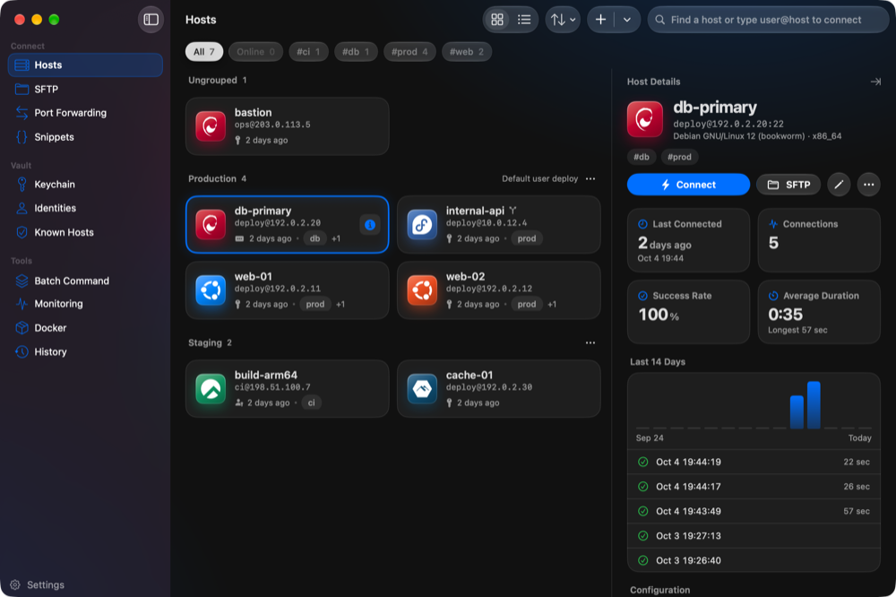

# Termi User Guide

## Table of Contents

- [Getting Started](#getting-started)
- [Finding Your Way Around](#finding-your-way-around)
- [Hosts](#hosts)
- [Connecting & Authentication](#connecting--authentication)
- [Terminal](#terminal)
- [SFTP File Transfer](#sftp-file-transfer)
- [Keychain (SSH Keys)](#keychain-ssh-keys)
- [Identities](#identities)
- [Known Hosts](#known-hosts)
- [Port Forwarding](#port-forwarding)
- [Snippets](#snippets)
- [Batch Command](#batch-command)
- [Monitoring](#monitoring)
- [Docker](#docker)
- [History](#history)
- [Security](#security)
- [Settings](#settings)
- [Backup, Restore and Encrypted Export](#backup-restore-and-encrypted-export)
- [Keyboard Shortcuts](#keyboard-shortcuts)
- [Where Your Data Lives](#where-your-data-lives)
- [Troubleshooting](#troubleshooting)

---

## Getting Started

### Installation

1. Download `Termi-<version>.dmg` from [GitHub Releases](https://github.com/example/Termi/releases)
2. Open the DMG and drag **Termi** into your **Applications** folder
3. On first launch, macOS Gatekeeper will block the app. Right-click the app icon and select **Open**, then confirm in the dialog

Termi needs macOS 15 or later. On macOS 26 and later its controls are drawn in Liquid Glass; on
macOS 15 the same interface uses the standard materials.

### Bring your existing servers

If you already use `ssh` in Terminal, open **Hosts**, click the arrow next to **+** in the toolbar and
choose **Import from ~/.ssh/config**. Termi imports every concrete `Host` entry with its HostName,
User, Port, IdentityFile (the keys go into the encrypted Keychain), ProxyJump chains and
Local/Remote/Dynamic forwards. `Host *` defaults and `Include` files are applied the way `ssh`
applies them; `Match` blocks are ignored. Hosts that already exist are skipped, so importing twice
is safe.

---

## Finding Your Way Around



### The sidebar lists pages

- **Connect**: Hosts, SFTP, Port Forwarding, Snippets
- **Vault**: Keychain, Identities, Known Hosts
- **Tools**: Batch Command, Monitoring, Docker, History
- At the bottom: **Settings** (`⌘,`) and, once a master password is set, the **Lock** button (`⇧⌘L`)

A number next to **SFTP** or **Port Forwarding** counts what is going on right now (running
transfers, active tunnels). How many records a page holds is said on the page itself.

### Sessions are tabs in the toolbar

Open sessions are not listed in the sidebar. They are the tabs in the window's toolbar:

- While a terminal is showing, each tab carries the host's tile (with a dot for the session's
  state), its title and a close button. **+** opens a local terminal; the menu next to it lists
  the hosts you connected to last
- While a page is showing, the tabs shrink to their tiles. Click a tile to go back to that session;
  click a page in the sidebar to leave the terminal again
- Tabs that do not fit are in the **+N** menu at the end of the group

Sessions keep running while you look at another page, and each window has its own tabs.

### Most pages are a list next to a record

The vault pages and the tools show a list on the left and the selected item on the right. The
Hosts page shows the hosts as cards over the whole page; a host's record opens in a panel at the
right only when you ask for it (see [Hosts](#hosts)). The toolbar holds the page's actions and its search field. If a page cannot read its data it shows
the error with a **Retry** button instead of an empty list.

### Command palette

`⌘K` opens the command palette. Type to find open sessions, recent and saved hosts, snippets, actions
(New Terminal, Quick Connect, Import SSH Config, Lock App, Split, Broadcast, Open SFTP, Reconnect)
and pages. `↑` `↓` select, `Return` opens, and `⌘Return` opens SFTP for the selected host. Typing
`user@host` offers to connect without saving the host.

### Windows

`⌘N` opens another window with its own tabs, pages and selection. Closing a window ends its
sessions; Termi asks first (see [Closing and quitting](#closing-and-quitting)).

---

## Hosts

### The host cards and the host's details

The page shows each host as a card with a tile, its name, `user@address`, how it signs in, when it
was last connected (or its open sessions) and its tags. Click a card to select it; nothing is
selected until you do.

A host's record is not on the page until you ask for it. To open it in the **Host Details** panel
at the right:

- point at a card and click the **ⓘ** button that appears at its right edge (the selected card
  keeps the button), or
- select a card and press `⌘I` (**View → Show Host Details**), or
- right-click a card and choose **Show Details**

While the panel is open it follows the selection: select another card and it shows that host. Close
it with the button at the top of the panel, with `⌘I`, or with the card's button again. It also
closes when its host is deleted or a search or filter hides it. A new window and every launch start
with the panel closed. **Show in Hosts** on another page opens the Hosts page with that host's
details showing.

The panel shows:

- **Connect**, **SFTP**, **Edit** and a **⋯** menu (Copy Address, Duplicate, Delete)
- Last connection, number of connections, success rate and average duration
- Its **Port Forwarding** rules, each with a switch to start or stop the tunnel
- The connections of the last 14 days as a chart, and the latest sessions. A session with a saved
  transcript opens it
- **Configuration**: authentication, operating system, host key, group, startup snippet, terminal
  theme, forwarding options and notes
- A **Route** diagram when the host is reached through a jump host

Double-click a host (or select it and press `Return`) to connect. The arrow keys move the selection
through the cards. Right-click for **Connect**, **Open SFTP**, **Show Details**, **Copy Address**,
**Edit**, **Duplicate** and **Delete**. `⌫` deletes the selected host after a confirmation.

The toolbar switches between the **cards** and a **list** of full-width rows (the details panel
works the same in both; the cards are what you start with), sorts by **Name** or **Recently used**, and
its **+** menu has **New Host**, **New Group**, **Quick Connect…**, **New Local Terminal** and
**Import from ~/.ssh/config**.

### The host's tile shows its system

After a saved host connects, Termi runs one read-only command on it (once per host and app run)
to read `/etc/os-release` and `uname`, and shows the distribution's mark and colour on the host's
tile — Ubuntu, Debian, Fedora, Rocky, Alpine, FreeBSD, macOS, Windows and others. Distributions
without a mark of their own (for example Kylin or openEuler) show the Linux mark. The record
shows the system's name and architecture. Turn this off with **Settings → General → Read a host's
system after it connects**. A tile colour can also be set by hand in the host form.

### Adding a host

1. Go to **Hosts** and choose **+** → **New Host**
2. Fill in:
   - **Label**, **Address** (IP or domain), **Port**, **Username**
   - **Group** (optional)
   - **Credentials**: an **Identity**, or a **Password** and/or an **SSH Key**. Choose
     *System SSH agent / ~/.ssh keys* to use the keys that plain `ssh` would use. A password left
     empty is asked for when connecting
3. Optional sections:
   - **Connection** — **Jump Host**: connect through another saved host first (ProxyJump). Jump
     hosts can be chained; each hop uses its own credentials. **Agent forwarding**, and
     **X11 forwarding** (needs XQuartz)
   - **Port Forwarding** rules — enabled rules start when you connect
   - **Terminal** — a **Startup Snippet** typed into the shell after connecting, a colour
     **Theme** for this host only, and the tile's **Color**
   - **Notes** and **Tags**
4. Click **Add** (or **Save** when editing)

### Groups

Groups can carry defaults for the hosts inside them: **username**, **identity** and **jump host**.
A host that leaves these empty inherits them from its group (the form shows the inherited value).
Right-click a group header to add a host to it, edit it or delete it. Deleting a group keeps its
hosts; they become ungrouped.

### Tags, search and sorting

- The chips above the hosts filter them: **All**, **Online** (hosts with a live session) and one chip
  per tag
- The search field matches label, address, username, notes and tags
- Sort by **Name** or **Recently used**

### Search-to-connect

Type `user@host` or `user@host:port` into the search field and press `Return`: an SSH session opens
immediately without saving a host. You are asked for the password when needed.

### Quick Connect

`⇧⌘N` opens **Quick Connect**. Type `user@hostname` or `user@hostname:port`; the sheet reads the
address back as user, host and port. If it matches a saved host, that host is shown and used; if
not, the sheet says so and offers an optional password field. Recent connections are listed below
— click one to fill it in.

---

## Connecting & Authentication

- Termi keeps **one SSH connection per host**. Additional tabs, split panes, the SFTP browser,
  port forwards and the tools on the same host reuse it — you authenticate once and they open
  instantly. The connection closes automatically shortly after its last user goes away
- When the server asks for something Termi does not have stored, a sheet appears:
  - **Password** / **key passphrase** — tick *Save to vault* to store it encrypted
  - **Keyboard-interactive** prompts such as 2FA / OTP codes
  - **New host key** — compare the fingerprint with the one on the server, then
    **Trust & Connect**. Trusted keys are kept under **Known Hosts**
- A host whose key **differs from the trusted one** is not asked about: the connection is refused
  and the pane says that the host key has changed. Only if you trust the change, remove the old
  key under **Known Hosts** and connect again
- An answer the server does not accept is asked for again with a note. Cancelling a prompt ends the
  attempt without a failure message
- While it connects, a pane shows a card with the sign-in method and a **Cancel** button. A failed
  connection shows the reason with **Retry**, **Edit Host…**, **Copy Error** and **Close**
- **Auto-reconnect**: if the connection drops, the pane shows *Connection lost* and tries again
  after 1, 2, 4 … seconds (30 at most), and immediately when the network comes back or the Mac
  wakes. **Reconnect Now** skips the wait. Turn it off with **Settings → General → Reconnect
  automatically when the connection drops**
- While the app is locked, no authentication prompt is shown

### Closing and quitting

Closing a pane, a tab or a window, and quitting the app, ask the same question when a live SSH
session would be disconnected. *Don't ask again* in that dialog and **Settings → General → Confirm
before closing SSH session** are the same setting. Whatever that setting says, Termi always asks
when closing would cancel SFTP transfers or end the editing of a remote file whose changes the
server has not received.

---

## Terminal


### Tabs

- `⌘T` opens a local terminal tab; connecting to a host opens a tab for it
- `⌘1`–`⌘9` select a tab, `⌘[` / `⌘]` the previous / next one
- Right-click a tab for **Duplicate Tab** (a new session on the same connection), **Split Right**,
  **Split Down**, **Close Tab**, **Close Other Tabs**, **Close Tabs to the Right** and
  **Close All Tabs**. Drag tabs to reorder them
- A tab's tile shows the worst state among its panes: failed, connecting, ended or live

### Split panes

- **Split Right** `⌘D`, **Split Down** `⇧⌘D`; the new pane runs what the focused pane runs. Move
  between panes with `⌥⌘]` / `⌥⌘[`; drag a divider to resize
- In a split tab each pane has a header that names the program running in it (and the host, when
  it is not the tab's host), lit where typing goes, with a close button
- `⌘W` closes the focused pane, or the tab when it is the last one. `⇧⌘W` closes the window

### Broadcast input

**Broadcast Input to All Panes** `⇧⌘B` types your keystrokes into every pane of the tab — handy
for running the same command on several servers. Panes are marked while it is on. It is available
in a split tab.

### Status bar

A floating bar under the panes says, for the focused pane: the address (and the jump host it goes
through), the state (Connected, Connecting, Reconnecting, Session ended, Failed — Running for a
local shell), how long it has been up, the number of active tunnels and the grid size.

### Inspector

`⇧⌘S` (or the toolbar button) opens the inspector next to the terminal. It has two tabs:

- **Snippets** — search your snippets and **Paste into terminal** or **Run in terminal** in the
  focused pane. A snippet with `{{variables}}` asks for their values first; every variable has to
  be filled in. With broadcast on, it runs in every pane
- **Info** — the focused session's host, authentication, operating system, group, terminal theme
  and startup snippet, its port forwards with their state, and **Open in Monitoring** /
  **Show in Hosts**

### Find, clear, zoom

- **Find** `⌘F` with next / previous `⌘G` / `⇧⌘G`; options for match case, regular expression and
  whole word
- **Clear Buffer** `⌥⌘K`
- Font size `⌘=` / `⌘-` / `⌘0`
- Right-click inside the terminal for Copy, Paste, Find…, Clear Buffer, Split Right, Split Down,
  Open SFTP, Edit Host…, Reconnect and Close Pane
- `⇧⌘O` opens SFTP for the focused pane's host, `⇧⌘R` reconnects it

### Appearance and behaviour

In **Settings → Terminal**: 12 colour themes (Default Dark, Default Light, Dracula, Solarized Dark,
Solarized Light, Nord, Monokai, One Dark, Tokyo Night, Gruvbox Dark, Catppuccin Mocha, Rosé Pine)
with a live preview, font and font size, cursor style, bell (Flash / Sound / Off), scrollback size
(for new sessions), *Use Option as Meta key*, *Copy text on selection* and *Close the tab when the
shell exits*. A host can have a theme of its own.

When a shell exits and the tab stays open, the pane shows *The session ended.* with **Reconnect**
(for SSH) and **Close**.

---

## SFTP File Transfer

1. Go to **SFTP** and choose a host — or press `⇧⌘O` in a terminal to browse the focused host. A
   host that already has a connection uses it: there is no second login
2. The left card is your Mac, the right card the server. Each has a path bar with breadcrumbs
   (click a step to go there) and buttons for the enclosing folder and the home folder; the remote
   card also has **Back** and **Refresh**, and `⌘L` lets you type a path there

| Action | How |
|--------|-----|
| Upload | Drag files/folders from the left card or Finder onto the right card, or **Upload** |
| Download | Drag items from the right card onto the left card, or **Download** |
| Open folder | Double-click it |
| New Folder | **New Folder** in the remote card |
| Rename / Permissions | Right-click → **Rename…** / **Permissions…** (for example `755`) |
| Copy the path | Right-click → **Copy Path** |
| Delete | Right-click → **Delete**, or `⌫`. The confirmation names what goes; folders are deleted with their contents. The server has no Trash |
| Edit a remote file | Double-click a file, or right-click → **Edit in Default App**; every save is uploaded automatically |
| Local files | Right-click → **Upload**, **Reveal in Finder**, **Move to Trash** |

The toolbar has **Show Hidden Files** (both cards at once), **Terminal** (a terminal on this host)
and **Disconnect**.

### Transfers

Transfers appear in a floating bar at the bottom: progress, speed, time left and a cancel button
for each. The bar can be collapsed to one line, and **Clear Finished** removes completed entries.
Up to four transfers run at once; the rest wait. Folders are transferred recursively.

### What SFTP does to protect your files

- A download is written to a `.part` file first. If a file of that name is already there, the old
  one is moved to the Trash before the new one takes its place
- A rename never overwrites another file silently
- The local copy of a remote file you are editing is deleted only when the server has all its
  changes. Otherwise it is moved to the Trash and the page says so — also after a crash
- Links are not followed, and pipes, devices and sockets are not downloaded; a finished transfer
  says what it skipped
- A file whose name is not valid UTF-8 is listed but cannot be acted on: rename it on the server
  first
- An action the server refuses is reported in an alert and the file list stays; only a folder that
  cannot be listed shows an error in place of the list

---

## Keychain (SSH Keys)


- **Generate…**: Ed25519 (recommended) or RSA 4096, with an optional passphrase
- **Import…**: from a file or pasted text
- The list groups keys into **In Use** and **Unused**. A key's record shows its type and date, a
  strength mark (**Weak** for RSA below 3072 bits and for DSA), its fingerprint as text and as the
  same image `ssh-keygen -lv` draws, the public key (copy or share), and the hosts and identities
  that use it
- **Install on Host…**: appends the public key to `~/.ssh/authorized_keys` on the selected hosts
  (only once per host). You may be asked for the host's password. Installing does not change how
  Termi signs in to those hosts: choose the key in the host form (or in the host's identity)
- Deleting a key says how many hosts will no longer be able to sign in with it
- Keys live in Termi's encrypted vault, not in `~/.ssh/`

---

## Identities

An identity is one set of sign-in details — a username with a password and/or an SSH key — shared
by many hosts. Assign it to hosts or to a group so credentials are managed in one place.

The page lists identities with how they sign in and how many hosts use them. An identity's record
shows its credentials, the hosts and groups that use it (including hosts that inherit it from
their group), and **Show in Keychain** for its key. Editing an identity says how many hosts the
change affects; deleting it says how many hosts will no longer be able to sign in with it.

---

## Known Hosts

Host keys you trusted on a first connection. Entries with the same key are shown as one machine
with its addresses. The record shows the key type, when you trusted it, the fingerprint, the other
addresses of the machine, the saved hosts that use it and the public key.

- **Remove…** forgets one entry; you verify the host again next time
- The **⋯** menu has **Remove Entries Without a Saved Host…** (lists them first) and
  **Remove All Known Hosts…**

---

## Port Forwarding

| Type | Direction | Use case |
|------|-----------|----------|
| **Local** (`-L`) | A port on your Mac → a destination reachable from the server | Reach a remote database locally |
| **Remote** (`-R`) | A port on the server → a destination reachable from your Mac | Expose a local service to the server |
| **Dynamic** (`-D`) | SOCKS proxy on a port of your Mac | Route traffic through the server |

- Add rules in the host form or with **New Rule** under **Port Forwarding** (choose the host, then
  the rule). The form shows the rule as its `ssh` option
- The page lists rules by host. Each rule has a switch that starts or stops its tunnel on its own
  and shows its state (connecting, running, failed to start)
- The rule's menu has *Starts automatically with a terminal session*, **Copy Address**,
  **Copy as ssh Command** (copied only — Termi never runs it), **Open in Browser** (a running
  local forward), **Edit** and **Delete**
- A host's rules also appear, with their switches, in the host's record and in the terminal
  inspector's **Info** tab
- Forwards run on the host's shared connection

---

## Snippets

- Create snippets under **Snippets** with a name, an optional category and description. Use
  `{{name}}` for values you fill in when running, e.g. `tail -n {{lines}} -f {{logfile}}`
- The list filters by category. A snippet's record shows the command, fields for its variables,
  the open sessions it can run in (**Run In**) and the hosts that use it as their startup snippet
- **Run** sends it to the chosen session; it is off until a session is open and every variable is
  filled in
- In a terminal, the inspector's **Snippets** tab (`⇧⌘S`) pastes or runs a snippet in the focused
  pane
- A host can run a **Startup Snippet** right after connecting

---

## Batch Command

1. Tick the hosts (or **Select All**)
2. Type a command — or pick one from **History** (commands run before) or **Snippets**. Snippets
   with `{{variables}}` are listed but cannot be inserted: batch does not fill in templates
3. **Run** (`⌘Return`)

Results show how many hosts succeeded, failed or are still running, and the slowest one. View them
**By Host** (each with exit code and duration) or **By Output**, which groups hosts that returned
the same output. **Copy All Output** copies everything; **Clear** empties the results.

---

## Monitoring


Select a host to read its CPU, memory and disk usage, load averages (1 / 5 / 15 min), network
bytes received and sent, uptime and process count. High and critical levels are marked with a
word. **Refresh** is `⌘R`; **Auto Refresh** reads every 5 seconds and draws CPU and memory over
the last 5 minutes.

Monitoring runs standard commands on the host (`uptime`, `free`, `df`, `top`, `/proc`), so it is
meant for Linux servers; other systems may show only part of the figures.

---

## Docker


Select a host that has Docker. The table lists its containers with name, image, ports and status;
switch between **Running** and **All**. Select a container to **Start**, **Stop**, **Restart** or
**Remove** it (with a confirmation) and to read its **Logs**. Right-click to copy its name or ID.
**Refresh** is `⌘R`.

---

## History


Every SSH session to a host is recorded.

- The cards at the top are worked out from **every** record, not only the listed ones: connections
  (and how many today), success rate, average and longest duration, the host connected to most,
  and the last 30 days
- The table lists the latest 200 records and says so when there are more. `⌘R` refreshes
- Search looks at **every** record, not only the listed ones: host, address, error text and the
  state as the table shows it. It lists the newest 200 matches and says how many there are
- Select a record to see when it started and ended and the last lines of its output;
  **Open Full Transcript** shows all of it. **Reconnect** opens a new session to that host
- Right-click a record for **View Session Transcript**, **Reconnect**, **Copy Address** and
  **Copy Error Message**

What is kept and what is removed:

- A session's terminal output is saved as a transcript file (up to 50 MB per session) in the
  `SessionLogs` folder (see [Where Your Data Lives](#where-your-data-lives))
- Records older than 90 days are removed when the app starts, together with their transcripts
- **⋯ → Clear History…** removes all records **and the session output saved with them** after a
  confirmation; this cannot be undone
- Deleting a host removes its history and the saved output of those sessions too; the
  confirmation says so
- After a restore or an encrypted import the replaced database is kept for rolling back, and so
  are the transcripts its records refer to; those are removed once they are 90 days old

---

## Security

### The vault

- Saved passwords, key passphrases and private keys are encrypted with AES-256-GCM and stored in
  Termi's own database — **not** in the macOS Keychain, and nothing is synced to any cloud
- Without a master password they are encrypted with a key file on this Mac (`.vault-key`)
- With a master password they are encrypted with a key derived from it (PBKDF2-SHA256, 600,000
  iterations). Setting or removing the master password re-encrypts everything in one step

### Master password and lock

- Set it under **Settings → General → Security → Master Password** (at least 8 characters). **It
  cannot be recovered if you forget it**
- With a master password, Termi starts locked and can be locked at any time with `⇧⌘L`, the lock
  button in the sidebar or **Lock Now** in Settings
- While locked, a window shows only the lock screen: pages, sheets and prompts are gone, menu
  commands do nothing, and the Settings window is locked as well. **Sessions stay connected in the
  background**; the lock screen says how many
- After 5 wrong passwords in a row, unlocking is blocked for 30 seconds, doubling with each further
  failure up to one hour
- **Remove…** takes the master password away (only while unlocked). Saved passwords and keys are
  kept and go back under the key file; the app can then no longer be locked

### SSH

- Host key verification with Termi's own known-hosts list; changed keys are refused
- Passwords, passphrases and one-time codes reach `ssh` through a private helper, never on a
  command line or in an environment variable
- Keep-alive detects broken connections
- When the app quits it closes its SSH connections

---

## Settings

Open with **Settings** in the sidebar or `⌘,`.


| Tab | What is there |
|-----|---------------|
| **General** | App appearance (System / Light / Dark) and language (Follow System, English, 简体中文); reconnect automatically, connection timeout (5–60 s), keep-alive interval (5–120 s), *Apply options from ~/.ssh/config*, *Confirm before closing SSH session*, *Read a host's system after it connects*; master password |
| **Terminal** | Live preview, colour theme, font, font size, cursor style, bell, scrollback, Option as Meta, copy on selection, close the tab when the shell exits |
| **Import / Export** | Hosts as CSV (import and export), import of an SSH config file |
| **Sync** | Encrypted export and import of everything (see below) |
| **Backup** | Database backups and restore (see below) |
| **Notifications** | System notifications while Termi is in the background: SSH connection (connects, disconnects, fails), SFTP transfer (longer than 3 seconds), batch command (every host finished) |
| **About** | Version, automatic updates, **Check Now** |

Notes:

- A change of language applies to menus, system dialogs, dates and some messages the next time
  Termi starts
- *Apply options from ~/.ssh/config* lets hosts pick up settings from your own SSH config (for
  example legacy algorithms for old network gear). Only values your config actually changes are
  taken. Hosts that use *System SSH agent / ~/.ssh keys* also take the `IdentityAgent` (1Password,
  Secretive…), `IdentityFile` and `CertificateFile` your config gives them; hosts with a key from
  the vault or a password never do
- CSV columns: `label,hostname,port,username,auth_type,group,notes,ssh_config_alias`. The last column
  is optional when importing older files. It preserves the original SSH config matching name
  independently of the host's display label and connection address. A CSV file never contains
  passwords or keys

---

## Backup, Restore and Encrypted Export

### Backup (Settings → Backup)

- **Create Backup…** saves a full copy of the database as one file, wherever you choose. The pane
  shows how large it will be and when the last backup was made
- **Backup Files** lists the backups made from here that still exist, and the databases a restore
  or an import replaced (marked *Replaced database*), each with **Reveal in Finder** and
  **Restore…**. The list is checked against the files whenever the pane appears or Termi comes
  to the front: a backup you deleted is no longer listed and no longer counts as the last backup
- A backup on a disk that is not connected stays in the list, marked **Disk not connected**; one
  in a folder Termi may not read is marked **Cannot be read**. **Remove from List** takes an
  entry off the list without touching any file
- A backup does **not** include the key file (`.vault-key`). Without a master password, the saved
  passwords and SSH keys in a backup cannot be decrypted on another Mac. To move data between
  Macs, use the encrypted export

### Restore

**Restore…** on a listed backup, or **Choose File…** for any other one. The file is checked first.
After a confirmation all data is replaced by the backup; the database that was there is kept
beside it as `termi.before-restore-<date>.db`. Restart Termi afterwards.

### Encrypted export and import (Settings → Sync)

- **Export…** asks for a password and writes everything — hosts, keys, identities, snippets,
  settings and saved secrets — into one file encrypted with AES-256-GCM:
  `~/.termi/sync/termi-sync.json`. The secrets in it are protected by that password alone, so
  the file can be opened on another Mac. If a stored secret could not be read, the export says
  how many were left out
- **Import…** asks for the password and the file, reads it, and then asks whether to replace
  **everything** in Termi with it, saying how many hosts, keys and identities it brings. The
  current database is kept first as `termi.before-import-<date>.db`

There is no cloud sync: moving the exported file is up to you.

---

## Keyboard Shortcuts

`⌘/` shows this list in the app.

### General

| Shortcut | Action |
|----------|--------|
| `⌘K` | Command palette |
| `⇧⌘N` | Quick Connect |
| `⌘I` | Show or hide the details of the selected host (Hosts page) |
| `⌘/` | Keyboard shortcuts |
| `⇧⌘L` | Lock app (with a master password) |
| `⌘,` | Settings |
| `⌘Q` | Quit |

### Tabs and windows

| Shortcut | Action |
|----------|--------|
| `⌘T` | New terminal tab |
| `⌘N` | New window |
| `⌘W` | Close tab or pane (on a page: close the window) |
| `⇧⌘W` | Close window (while a terminal is showing) |
| `⌘1`–`⌘9` | Select tab 1–9 |
| `⌘[` / `⌘]` | Previous / next tab |

### Panes

| Shortcut | Action |
|----------|--------|
| `⌘D` / `⇧⌘D` | Split right / split down |
| `⌥⌘]` / `⌥⌘[` | Next / previous pane |
| `⇧⌘B` | Broadcast input to all panes |

### Terminal

| Shortcut | Action |
|----------|--------|
| `⇧⌘S` | Snippets (inspector) |
| `⇧⌘O` | Open SFTP for the focused host |
| `⇧⌘R` | Reconnect |
| `⌥⌘K` | Clear buffer |
| `⌘=` / `⌘-` / `⌘0` | Increase / decrease / reset font size |
| `⌘F` | Find |
| `⌘G` / `⇧⌘G` | Find next / previous |
| `⌘C` / `⌘V` / `⌘A` | Copy / paste / select all |

### Tools

| Shortcut | Action |
|----------|--------|
| `⌘R` | Refresh (Monitoring, Docker, History) |
| `⌘Return` | Run the batch command |

### Inside pages and sheets

| Where | Key | Action |
|-------|-----|--------|
| Hosts | `Return` | Connect to the selected host (or to the `user@host` typed in the search field) |
| Hosts | `⌫` | Delete the selected host (asks first) |
| SFTP, remote card | `⌘L` | Type a path |
| SFTP, remote card | `⌫` | Delete the selection (asks first) |
| Command palette | `↑` `↓` / `Return` / `⌘Return` | Select / open / open SFTP for the selected host |
| Install Public Key | `⌘A` | Select or deselect all hosts |

---

## Where Your Data Lives

| What | Where |
|------|-------|
| Database: hosts, groups, tags, identities, keys (encrypted), saved passwords (encrypted), snippets, port forwards, known hosts, history, settings | `~/Library/Application Support/Termi/termi.db` (with `termi.db-wal` and `termi.db-shm` beside it) |
| Vault key file (used when no master password is set) | `~/Library/Application Support/Termi/.vault-key` |
| Session transcripts | `~/Library/Application Support/Termi/SessionLogs/` |
| Databases kept by a restore or an import | `~/Library/Application Support/Termi/termi.before-*.db` |
| Preferences (language, view modes, "don't ask again", window positions) | the app's preferences domain `dev.termi.Termi` |
| Encrypted export | `~/.termi/sync/termi-sync.json` |
| Backups | wherever you saved them |
| Local copies of remote files being edited | a private folder in the temporary directory, cleaned up when editing ends |

Nothing is stored in the macOS Keychain or in iCloud.

### A separate profile

Termi can run on a profile of its own — a second set of hosts, keys and settings — by starting it
with the environment variable `TERMI_PROFILE_DIR` set to an absolute folder:

```bash
open -n --env TERMI_PROFILE_DIR="$HOME/Termi-Work" /Applications/Termi.app
```

Everything then lives inside that folder: the database, the vault key, session transcripts,
`Preferences.plist`, `sync/` for encrypted exports and `Backups/` as the suggested backup folder.
The standard profile is not read or written. The folder must not be the standard profile folder or
lie inside it, and if it cannot be used Termi does not start — it never falls back to the
standard profile. Automatic updates are only available in the standard profile.

---

## Troubleshooting

### App won't open (macOS Gatekeeper)

Termi is distributed outside the App Store with ad-hoc signing. On first launch right-click the
app → **Open** → **Open**, or use **System Settings → Privacy & Security → Open Anyway**.

### "Database Error" at launch

Termi could not open its database. Restart the app; if it happens again, check disk space and the
permissions of `~/Library/Application Support/Termi/`.

### SSH connection fails

- The card in the pane says what failed (refused connection, authentication, host key…);
  **Copy Error** copies it and **Edit Host…** opens the host
- Check address, port and username. The username is the identity's if the host has an identity,
  else the host's own, else the group's default
- For key authentication make sure the right key is selected, or choose *System SSH agent*
- "The host key has changed": the server was reinstalled, or someone is intercepting the
  connection. Only if you trust the change, remove the old entry under **Known Hosts** and connect
  again
- A saved password or key that "cannot be decrypted on this Mac" was encrypted with another key
  file or master password: enter the password again or re-import the key
- Old servers that need legacy algorithms: enable **Settings → General → Apply options from
  ~/.ssh/config** and put the options in your `~/.ssh/config`
- Keys in 1Password, Secretive or another agent: choose *System SSH agent / ~/.ssh keys* for the
  host and keep **Apply options from ~/.ssh/config** on, so the `IdentityAgent` (and any
  `IdentityFile`) from your `~/.ssh/config` is used
- Slow networks: raise **Settings → General → Connection Timeout**

### A session keeps reconnecting

The pane shows the attempt and a countdown. **Reconnect Now** tries at once, **Close** gives up.
To stop automatic reconnects altogether, turn off **Settings → General → Reconnect automatically
when the connection drops**.

### SFTP fails

- The server needs the `sftp` subsystem (standard with OpenSSH)
- An alert names the action the server refused — usually file permissions or a name that is taken
- A file that cannot be selected has a name that is not valid UTF-8; rename it on the server

### Monitoring or Docker shows an error

- Monitoring needs the usual Linux tools on the host; Docker needs the `docker` command and a user
  allowed to run it
- **Retry** runs the reading again

### Terminal display issues

- Try another theme or font in **Settings → Terminal**
- Alt-shortcuts in Emacs, readline or tmux need *Use Option as Meta key*; turn it off to type
  special characters with Option

### I forgot the master password

It cannot be recovered, and the saved passwords and keys encrypted with it cannot be read without
it. An encrypted export made earlier (protected by its own password) can be imported again.

### Data recovery

Restore a backup in **Settings → Backup** — the databases replaced by an earlier restore or import
are listed there too — or re-import hosts under **Settings → Import / Export**.
